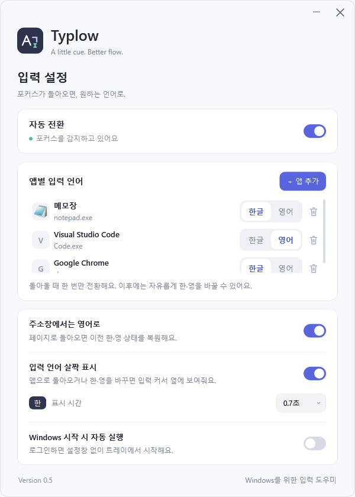

# Typlow

포커스가 돌아오면, 원하는 언어로.

Typlow는 앱마다 원하는 한글·영어 입력 상태를 설정하고, 브라우저 주소창에서는 영어로 전환해 주는 Windows용 입력 도우미입니다. 등록한 앱에서는 입력 커서 옆에 현재 입력 언어를 잠깐 표시합니다.

**[최신 버전 다운로드](https://github.com/BE0X01/typlow/releases/latest)** · Windows x64 · 별도의 .NET 설치 없이 실행

## 미리보기

## 주요 기능

- **앱별 입력 언어 설정** — 앱마다 한글 또는 영어를 선택할 수 있습니다. 다른 창으로 이동했다 돌아오면 한 번 적용하며, 사용 중에는 자유롭게 한·영을 바꿀 수 있습니다.
- **브라우저 주소창 영어 전환** — Chrome·Edge 주소창에 들어가면 영어로 전환하고, 페이지로 돌아오면 이전 한·영 상태를 복원합니다.
- **입력 언어 살짝 표시** — 등록한 앱으로 돌아오거나 한·영 키로 언어를 바꾸면 입력 커서 옆에 `한` 또는 `A`를 잠깐 표시합니다. 같은 앱에서 입력란만 바꿔도 반복해서 표시하지 않습니다.
- **실행 중인 앱·프로세스 검색** — 실행 중인 창에서 앱을 선택하거나, 프로세스를 검색하거나, 실행 파일을 직접 찾아 등록할 수 있습니다. 별도 호스트 창을 사용하는 Microsoft Store 앱도 실제 앱 실행 파일로 구분합니다.
- **트레이에서 간편하게 관리** — 설정창을 닫아도 트레이에 남아 동작합니다. 자동 전환을 일시정지하면 트레이 아이콘이 회색으로 바뀝니다.
- **Windows 시작 시 자동 실행** — 로그인하면 설정창 없이 트레이에서 시작하도록 설정할 수 있습니다.

## 사용 방법

1. [릴리즈 페이지](https://github.com/BE0X01/typlow/releases/latest)에서 `Typlow-0.5-win-x64.zip`을 내려받습니다.
2. 쓰기 권한이 있는 폴더에 압축을 풀고 `Typlow.exe`를 실행합니다.
3. **앱 추가**를 누르고 실행 중인 앱을 선택합니다. 목록에 없다면 **프로세스 검색** 또는 **파일 찾기**로 등록합니다.
4. 앱 오른쪽에서 원하는 입력 언어인 **한글** 또는 **영어**를 선택합니다.
5. 다른 창으로 이동했다가 등록한 앱으로 돌아오면 설정한 입력 언어가 한 번 적용됩니다.

트레이 아이콘을 두 번 클릭하면 설정창을 열 수 있습니다. 아이콘을 오른쪽 클릭하면 자동 전환을 일시정지·재개하거나 Typlow를 종료할 수 있습니다.

## 설정 안내

| 설정 | 설명 |
| --- | --- |
| 자동 전환 | 자동 전환을 켜거나 일시정지합니다. |
| 앱별 입력 언어 | 앱을 추가·삭제하고, 앱마다 적용할 한글·영어 상태를 선택합니다. |
| 주소창에서는 영어로 | Chrome·Edge 주소창에서 영어로 전환하고, 페이지로 돌아오면 이전 상태를 복원합니다. |
| 입력 언어 살짝 표시 | 등록한 앱의 입력 커서 옆에 현재 언어를 짧게 표시합니다. |
| 표시 시간 | 입력 언어 표시가 유지되는 시간을 선택합니다. |
| Windows 시작 시 자동 실행 | Windows 로그인 후 트레이에서 자동으로 시작합니다. 기본값은 꺼짐입니다. |

## 설정 저장 및 업데이트

옵션과 앱 목록은 **`Typlow.exe`와 같은 폴더의 `Typlow.ini`**에 저장됩니다. 처음 설정을 변경하면 파일이 생성되고, 이후 옵션이나 앱 목록이 바뀔 때 저장합니다. 주기적으로 같은 내용을 다시 저장하지 않습니다.

기존 `%LOCALAPPDATA%\Typlow\settings.json`이 있고 EXE 옆에 INI가 없다면, 기존 설정을 한 번 가져옵니다. 원래 JSON 파일은 보관하며 이후에는 INI를 사용합니다.

업데이트할 때는 트레이 메뉴에서 Typlow를 종료한 뒤, **`Typlow.ini`를 보존하면서** 프로그램 파일을 교체하세요. 다른 폴더로 옮길 때도 EXE와 INI를 함께 복사하면 됩니다. 자동 실행이 켜져 있다면 새 위치에서 Typlow를 한 번 실행해 시작 경로를 갱신하세요.

## 라이선스

Typlow는 [MIT 라이선스](LICENSE)로 제공됩니다. 함께 배포되는 .NET 런타임의 라이선스와 제3자 고지는 릴리즈 ZIP의 `licenses` 폴더에 포함되어 있습니다.